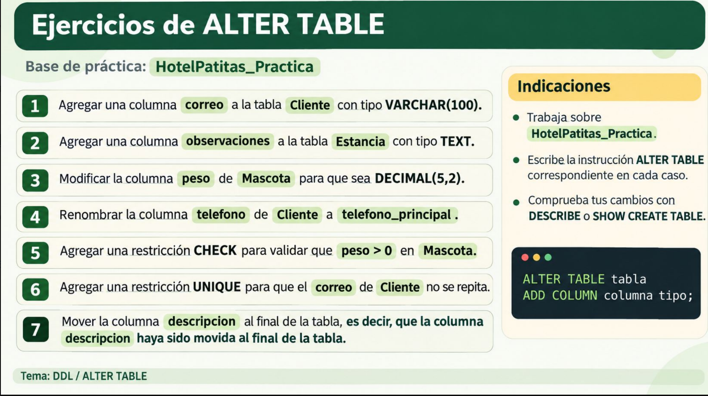

# BASES DE DATOS - IAIA

Repositorio para las actividades y prácticas de la unidad de aprendizaje **Bases de Datos**.

## Datos del estudiante

- **Nombre:** Querén Mercado Bernardino.
- **Grupo:** 301 IA IA

## Actividades
04 - CREACIÓN DE BASE DE DATOS HOTELPATITAS_PRACTICA (y ejercicios de la diapositiva sql - ddl.)

05 - ALTER TABLE


# ACTIVIDAD 04 - CREACIÓN DE BASE DE DATOS HOTELPATITAS_PRACTICA
### 1. CREACIÓN DE UNA NUEVA BASE DE DATOS -> HotelPatitas_Practica BASADA EN LA BASE DE DATOS HotelPatitas.
Los ejercicios se realizarán sobre esta copia y no sobre la base de datos original.
Código en MySQL:
```
CREATE DATABASE HotelPatitas_Practica;
USE HotelPatitas_Practica;
```
### 2. COPIO LAS TABLAS A MI BASE DE DATOS DE PRÁCTICA.
Código en MySQL:
```
CREATE TABLE Cliente AS SELECT * FROM Hotel_Patitas.Cliente;
CREATE TABLE Mascota AS SELECT * FROM Hotel_Patitas.Mascota;
CREATE TABLE Estancia AS SELECT * FROM Hotel_Patitas.Estancia;
CREATE TABLE Servicio AS SELECT * FROM Hotel_Patitas.Servicio;
CREATE TABLE EstanciaServicio AS SELECT * FROM Hotel_Patitas.EstanciaServicio;
```
### 3. AGREGO LAS LLAVES PRIMARIAS SIMPLES.
Código en MySQL:
```
ALTER TABLE Cliente
ADD PRIMARY KEY (id_cliente);
ALTER TABLE Mascota
ADD PRIMARY KEY (id_mascota);
ALTER TABLE Estancia 
ADD PRIMARY KEY (id_estancia);
ALTER TABLE Servicio 
ADD PRIMARY KEY (id_servicio);
```

### 4. AGREGO LA LLAVE PRIMARIA COMPUESTA.
Código en MySQL:
```
ALTER TABLE EstanciaServicio 
ADD PRIMARY KEY (id_estancia, id_servicio);
```

### 5. RECUPERO AUTO_INCREMENT PARA QUE MYSQL GENERE LOS IDENTIFICADORES AUTOMÁTICAMENTE.
Código en MySQL:
```
ALTER TABLE Cliente
MODIFY COLUMN id_cliente INT NOT NULL AUTO_INCREMENT;
ALTER TABLE Mascota
MODIFY COLUMN id_mascota INT NOT NULL AUTO_INCREMENT;
ALTER TABLE Estancia 
MODIFY COLUMN id_estancia INT NOT NULL AUTO_INCREMENT;
ALTER TABLE Servicio 
MODIFY COLUMN id_servicio INT NOT NULL AUTO_INCREMENT;
```
### 6. AGREGO CLAVES FORÁNEAS .
Relaciones Cliente-Mascota, Mascota-Estancia y Estancia-Servicio
Código en MySQL:
```
ALTER TABLE Mascota
ADD CONSTRAINT fk_mascota_cliente
FOREIGN KEY (id_cliente) REFERENCES Cliente(id_cliente);

ALTER TABLE Estancia 
ADD CONSTRAINT fk_estancia_mascota
FOREIGN KEY (id_mascota) REFERENCES Mascota(id_mascota);

ALTER TABLE EstanciaServicio
ADD CONSTRAINT fk_estancia_servicio_estancia
FOREIGN KEY (id_servicio) REFERENCES Servicio(id_servicio);
```

### 7. AGREGO COLUMNAS A LAS TABLAS.

- AÑADO A LA TABLA MASCOTA LA COLUMNA LLAMADA color.
Código en MySQL:
```
ALTER TABLE Mascota
ADD COLUMN color VARCHAR(30);
```

- AÑADO A LA TABLA CLIENTE LA COLUMNA LLAMADA codigo_externo.
Código en MySQL:
```
ALTER TABLE Cliente
ADD COLUMN codigo_externo  VARCHAR(20) FIRST;
```

- AÑADO A LA TABLA MASCOTA LA COLUMNA LLAMADA raza.
Código en MySQL:
```
ALTER TABLE Mascota
ADD COLUMN raza VARCHAR(50) AFTER especie;
```
  
- AÑADO A LA TABLA SERVICIO LA COLUMNA LLAMADA descripción.
Código en MySQL:
```
ALTER TABLE Servicio
ADD COLUMN descripcion VARCHAR(150) AFTER nombre;
```

### 8. MODIFICO LAS COLUMNAS MASCOTA Y SERVICIO.
Código en MySQL:
```
ALTER TABLE Mascota
MODIFY COLUMN raza VARCHAR(100);
ALTER TABLE Servicio 
MODIFY COLUMN descripcion VARCHAR(250) AFTER nombre;
```

### 9. RENOMBRO LAS COLUMNAS.
Código en MySQL:
```
ALTER TABLE Cliente
RENAME COLUMN telefono TO telefono_contacto;
ALTER TABLE Servicio
CHANGE COLUMN descripcion detalle VARCHAR(300);
```

### 10. ELIMINO COLUMNAS DE CLIENTE Y MASCOTA.
Código en MySQL:
```
ALTER TABLE Cliente
DROP COLUMN codigo_externo;
ALTER TABLE Mascota
DROP COLUMN color;
```

## 11. VALIDO LOS DATOS USANDO LA RESTRICCIÓN CHECK
Código en MySQL:
```
ALTER TABLE Mascota
ADD CONSTRAINT chk_peso CHECK (peso > 0);

ALTER TABLE Servicio 
ADD CONSTRAINT chk_precio CHECK (precio >= 0);

ALTER TABLE Estancia
ADD CONSTRAINT chk_fechas CHECK (fecha_salida > fecha_entrada);
```

## 12. EVITO DUPLICADOS USANDO UNIQUE.
Código en MySQL:
```
ALTER TABLE Servicio 
ADD CONSTRAINT uq_nombre_servicio UNIQUE (nombre);
```

## 13. ELIMINO LAS RESTRICCIONES.
Código en MySQL:
```
ALTER TABLE Mascota DROP CHECK chk_peso;
ALTER TABLE Servicio DROP INDEX uq_nombre_servicio;
ALTER TABLE Mascota DROP FOREIGN KEY fk_mascota_cliente;

```

## 14. RESTURO LAS CLAVES FORÁNEAS.
Código en MySQL:
```
ALTER TABLE Mascota
ADD CONSTRAINT fk_mascota_cliente
FOREIGN KEY (id_cliente)
REFERENCES Cliente(id_cliente);
```
## 15. COMPRUEBO LAS MODIFICACIONES.
Código en MySQL:
```

DESCRIBE Cliente;
DESCRIBE Mascota;
DESCRIBE Servicio;
DESCRIBE Estancia;
DESCRIBE EstanciaServicio;
SHOW CREATE TABLE Mascota;
SHOW CREATE TABLE EstanciaServicio;
SHOW CREATE TABLE Servicio;


```


# ACTIVIDAD 05. ALTER TABLE
### EJERCICIOS:


Estos ejercicios se ejecutarán sobre la Base de Datos HotelPatitas_Practica.

### 1. Agregar una columna correo a la tabla Cliente con tipo VARCHAR(100)
Código en MySQL:
```
ALTER TABLE Cliente
ADD COLUMN correo VARCHAR(100);

```

### 2. Agregar una columna observaciones a la tabla Estancia con tipo TEXT.
Código en MySQL:
```
ALTER TABLE Estancia
ADD COLUMN observaciones TEXT;
```
### 3. Modificar la columna peso de Mascota para que sea DECIMAL(5,2).
Código en MySQL:
```
ALTER TABLE Mascota 
MODIFY COLUMN peso DECIMAL (5,2);

```
### 4. Renombrar la columna telefono_contacto de Cliente a telefono_principal.
Código en MySQL:
```
ALTER TABLE Cliente
RENAME COLUMN telefono_contacto TO telefono_principal;

```
### 5. Agregar una restricción CHECK para validar que peso > 0 en Mascota.
Código en MySQL:
```
ALTER TABLE Mascota
ADD CONSTRAINT chk_peso CHECK (peso > 0);
```
### 6. Agregar una restricción UNIQUE para que el correo de Cliente no se repita.
Código en MySQL:
```
ALTER TABLE Cliente
ADD CONSTRAINT uq_correo
UNIQUE(correo)

```
### 7. Mover columna descripcion al final de la tabla.
Código en MySQL:
```
ALTER TABLE Servicio
ADD COLUMN descripcion VARCHAR(150) AFTER nombre;
```

### COMPROBACIÓN DE CAMBIOS CON DESCRIBE Y SHOW CREATE TABLE
Código en MySQL:
```

DESCRIBE Cliente;
DESCRIBE Mascota;
DESCRIBE Servicio;
DESCRIBE Estancia;
DESCRIBE EstanciaServicio;
SHOW CREATE TABLE Mascota;
SHOW CREATE TABLE EstanciaServicio;
SHOW CREATE TABLE Servicio;
```
